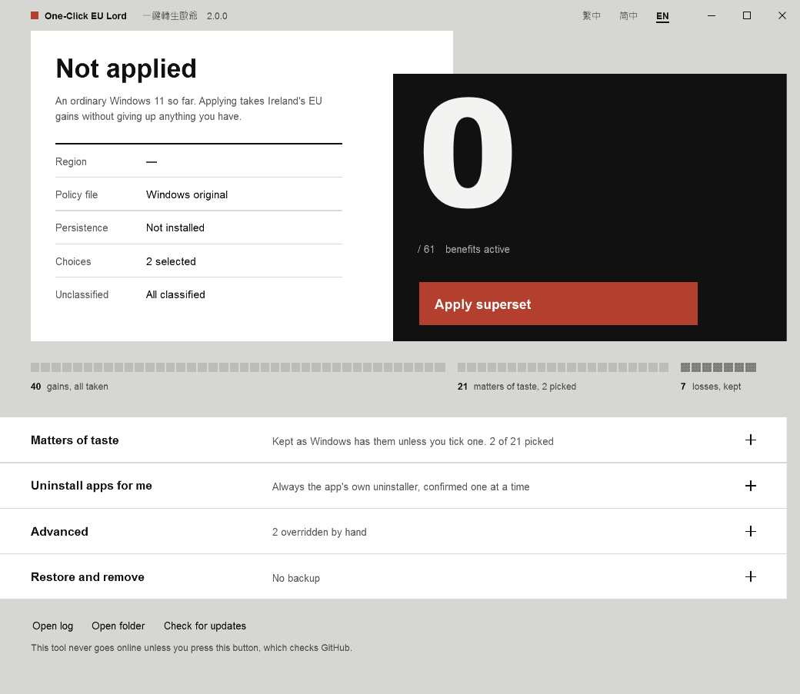

# One-Click EU Lord

[繁體中文](README.md) · [简体中文](README.zh-CN.md) · **English**

Gives an ordinary Windows 11 install the treatment Ireland gets under the EU and the EEA — **every gain, none of the losses** — and keeps it that way after Windows updates.



---

## Three steps

1. Download **`EULord.exe`** from [Releases](https://github.com/PZW152/one-click-eu-lord/releases/latest)
2. Double-click it and allow administrator rights
3. Press the red **Apply superset** button

That is the whole thing. Nothing to install, nothing to configure, no instructions to read.

### If Windows or your browser blocks it

There is **no code-signing certificate**, so Windows does not recognise this program. That is the most common reason people find it "doesn't work", and it says nothing about whether the program is sound:

- **The browser warns it is "not commonly downloaded"** → choose Keep on the download.
- **The blue "Windows protected your PC" screen** → More info → Run anyway.
- **Your antivirus objects** → to write one registry value the tool copies `reg.exe` to a temporary name (see [docs/HOW-IT-WORKS.md](docs/HOW-IT-WORKS.en.md) §7), and some scanners treat that as suspicious. The source is all here, and you can build it yourself.

If you would rather not click through those warnings, [building it yourself](#building-it-yourself) is one command and needs nothing installed.

---

## Why not just set the region to Ireland?

Because the EU build of Windows does not only *add* things. It also *removes* some.

Switching your region — the trick you will find everywhere — does unlock the EU benefits, but it also costs you Narrator's scripting extensions, the Xbox full-screen experience, the Clock and Calendar quick actions, and a few more. Those are switched off in the EU build.

So this tool classifies all **68** policies that differ between the EU and the rest of the world, one at a time:

| Class | Count | What happens |
|---|---|---|
| **Gain** | 40 | Takes the EU state |
| **Loss** | 7 | **Keeps Windows' own**, refuses the EU state |
| **Taste** | 21 | Keeps Windows' own unless you tick it |

That is what "superset" means here: everything the EU gets, and everything the EU gave up.

The full row-by-row table is in [docs/POLICIES.md](docs/POLICIES.md).

> Plainly stated: **out of the box this tool turns no existing feature off.** Only two things ever switch something off, and you do both of them yourself — the boxes you tick under "Matters of taste", and the apps you choose to uninstall.

---

## What it changes on your machine

| What | How |
|---|---|
| `C:\Windows\System32\IntegratedServicesRegionPolicySet.json` | Rewritten to the table above with the region conditions removed, after a backup |
| `HKLM\...\Control Panel\DeviceRegion` | Set to Ireland (GeoID 68) |
| Scheduled task `OneClickEULord-Persist` | Re-applies at logon, once a day, and **after a Windows update finishes** |
| `C:\ProgramData\OneClickEULord\` | Its own copy, settings, backups and log — everything in one folder |

Nothing else is touched. No service, no driver, nothing resident, and no network access unless you press "Check for updates".

---

## Undoing it

Open the tool and expand **Restore and remove**:

- **Restore** — puts the backed-up policy file back, returns the region to its old value, removes the scheduled task. Backups are kept.
- **Remove everything** — restores first, then deletes `C:\ProgramData\OneClickEULord\` entirely. Asks again before it does.

The `EULord.exe` you downloaded can be moved or deleted freely: the tool installs its own copy for the scheduled task to run.

---

## About uninstalling apps

The **Uninstall apps for me** section can remove Edge, Microsoft Store, Copilot, Phone Link, Widgets, Xbox, Teams, OneDrive and other Microsoft apps.

It **always runs the app's own registered uninstaller** — `Remove-AppxPackage` for Store apps, and the uninstall command Edge and OneDrive wrote into the registry themselves. It never deletes files by hand, never touches WinSxS, and never force-removes something that has no uninstaller. An app with no legitimate removal route is shown as not removable, with the reason. If an uninstaller fails, the exit code is reported as-is and **nothing falls back to deleting files**.

Every app is confirmed separately, one at a time. Anything you removed gets a **Reinstall** button pointing at the official source.

---

## Command line

Double-clicking opens the window. Any argument runs without one.

```
EULord.exe --apply                    apply the superset
EULord.exe --reapply                  apply only if the machine has drifted (what the task runs)
EULord.exe --restore                  undo
EULord.exe --purge --yes              undo, then delete the data folder
EULord.exe --status [--json]          report only, change nothing

EULord.exe --region IE                another EEA country, ISO code or GeoID
EULord.exe --choice Copilot,OfficeRecent    turn on these matters of taste
EULord.exe --override NarratorScripts=eea   force one policy (eea / global / auto)
```

Exit codes: `0` done, `1` failed, `2` bad usage, `3` needs administrator, `4` partly done.

Uninstalling apps is deliberately **not** available here. Removing software should need a person confirming each one, so it can never run unattended.

---

## Applied it but nothing changed?

Microsoft ships these features in waves, so writing a setting is not the same as the feature appearing. After applying, the tool **reads everything back** and reports each check as *In effect*, *Not yet in effect* or *Cannot tell*, with the likely reason — not restarted yet, the rollout has not reached this machine, or a domain/MDM policy is overriding it.

The log lives at `C:\ProgramData\OneClickEULord\logs\eulord.log` and is **always English with Gregorian dates**, so it can be pasted straight into an issue.

---

## Building it yourself

No SDK, no NuGet, no Visual Studio. .NET Framework 4.8 ships inside Windows 11.

```powershell
.\tools\Build.ps1     # produces dist\EULord.exe, about 165 KB
.\tools\Test.ps1      # 280 tests, no admin rights, touches nothing on the machine
```

How it works is in [docs/HOW-IT-WORKS.md](docs/HOW-IT-WORKS.md); the design decisions are recorded in [docs/SPEC.md](docs/SPEC.md).

---

## Documentation

| Document | What it covers |
|---|---|
| [docs/POLICIES.md](docs/POLICIES.md) | All 68 policies, generated from the code, in three languages |
| [docs/HOW-IT-WORKS.md](docs/HOW-IT-WORKS.md) | How Windows decides EU treatment, and where this tool steps in |
| [docs/SPEC.md](docs/SPEC.md) | The v2 specification and decision record (Chinese) |
| [docs/RELEASING.md](docs/RELEASING.md) | Release process, for maintainers |
| [SECURITY.md](SECURITY.md) | Security considerations and how to report a problem |
| [CHANGELOG.md](CHANGELOG.md) | Version history |

> User-facing documents come in three languages. Maintainer documents exist once, so translations cannot drift apart.

---

## Licence

[MIT](LICENSE). An independent open-source project, not affiliated with Microsoft.
