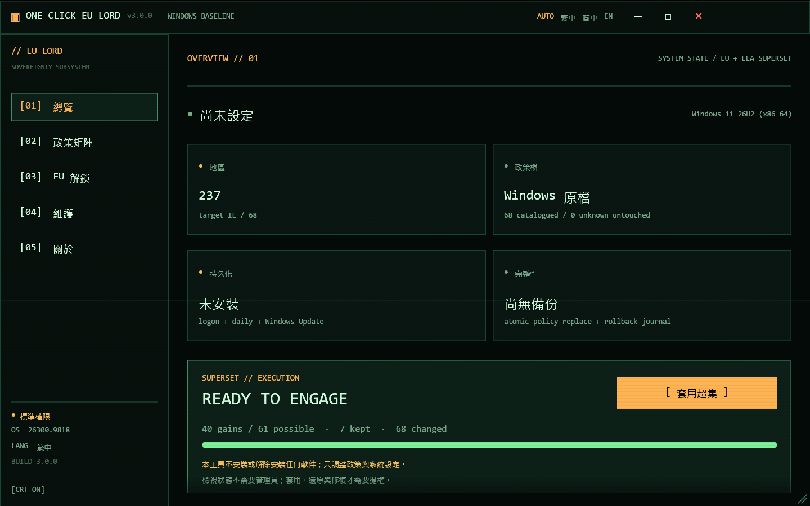

# One-Click EU Lord v3

[繁體中文](README.md) · [简体中文](README.zh-CN.md) · **English**

> Pure Rust rewrite. The UI is a real GUI styled like a retro-futurist TUI, fully mouse-operable.

> **This tool never installs or uninstalls software.** It only changes Windows EU/EEA policy data, the device region, and a persistence scheduled task. Use Windows Settings → Apps for software removal.

## Policy rule

The Windows EU/EEA policy set contains 68 entries that differ from the global set:

| Class | Count | Rule |
|---|---:|---|
| Benefit | 40 | Take the EU/EEA state |
| Loss | 7 | Keep the global state |
| Choice | 21 | Keep global unless the user opts into EU |

Unknown policies are left exactly as Windows shipped them: no rewrite, no removal of `conditions`.

## Screenshot



## Usage

1. Download `EULord.exe` from Releases.
2. Run it. The GUI starts with normal rights (`asInvoker`); UAC is requested only for apply/restore.
3. First launch: scan the OS build and policy file.
4. Review the 40/7/21 classification; choices are off by default.
5. Apply. The first apply shows a pre-flight diff; later applies are one-click.

Apply flow: backup → restore point → atomic policy replace → device region → scheduled task → verify. Critical failures roll back automatically. The task re-applies at logon, daily, and after Windows Update.

## Safety

- Atomic file replacement via `ReplaceFileW`/`MoveFileExW`.
- Backup, journal, verify, and rollback.
- Restrictive ACL on `C:\\ProgramData\\OneClickEULord` when elevated.
- On-demand UAC via `ShellExecuteExW(runas)`; no admin launch by default.
- No software-uninstall execution path; the EU Unlocks page is read-only policy information.

## CLI

```powershell
eulord status --json
eulord plan --json
eulord verify --json
eulord apply --json
eulord repair --json
eulord reapply --json
eulord restore --json
eulord purge --yes --json
eulord export .\\state.json
eulord import .\\state.json
```

Exit codes: 0 success, 1 error, 2 confirmation required, 3 administrator required, 4 partial/verify failure.

## Build

```powershell
cargo test --workspace --locked
cargo build --release --locked --bin eulord
.\\tools\\Build.ps1 -Profile release
.\\tools\\Test.ps1
```

MSVC/Windows SDK is recommended. For a local GNU toolchain, put WinLibs `mingw64\\bin` on `PATH` and use the GNU target.

## MSIX and signing

`packaging/` and `tools/Pack-Msix.ps1` contain the MSIX and `.appinstaller` auto-update pipeline, but no code-signing certificate is included. Provide a trusted PFX and update the `Publisher` in `packaging/AppxManifest.xml` to the certificate subject. Without a certificate, use the portable build.

## Data locations

- `C:\\ProgramData\\OneClickEULord\\`: installed copy, backups, journal, logs, state.
- `%LOCALAPPDATA%\\OneClickEULord\\state.json`: UI preferences and non-elevated state fallback.
- `C:\\Windows\\System32\\IntegratedServicesRegionPolicySet.json`: Windows policy file.
- `HKLM\\SOFTWARE\\Microsoft\\Windows\\CurrentVersion\\Control Panel\\DeviceRegion`: device GeoID.
- Scheduled task: `OneClickEULord-Persist`.

## Limitations

- Only x64 is verified; arm64 needs an arm64 target build and MSIX repackaging.
- Unknown policies are untouched, so future Windows builds are not automatically covered.
- MSIX code signing is an external prerequisite; portable is the default release.
- No software uninstall, UCPD bypass, Microsoft account change, or licensing change.

## License

MIT. Not affiliated with Microsoft.

