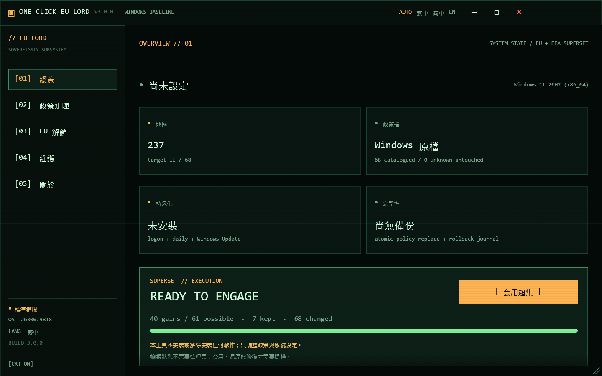
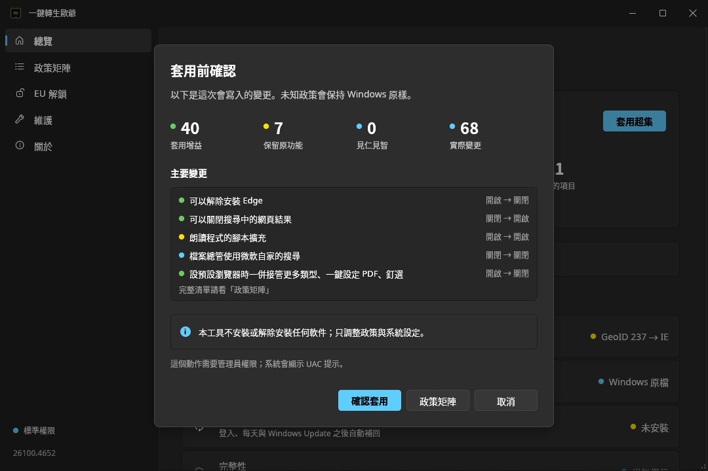

# 一鍵轉生歐爺 · One-Click EU Lord v3

**繁體中文** · [简体中文](README.zh-CN.md) · [English](README.en.md)

> 純 Rust 重寫。介面是復古未來主義 TUI 風格的實質 GUI：可以用滑鼠點擊，不是終端機程式。

> 重要：**本工具不安裝、不解除安裝任何軟件。** 它只調整 Windows 的 EU/EEA 政策檔、地區與持久化排程；軟件解除安裝請使用 Windows「設定 → 應用程式」。

---

## 這是什麼？

Windows 的 EU/EEA 政策檔裡有 68 條與全球版不同的條目。直接把地區改成愛爾蘭，會同時拿到好處與損失。v3 的規則是：

| 類別 | 數量 | v3 的處理 |
|---|---:|---|
| **好處 Benefit** | 40 | 採用 EU/EEA 狀態 |
| **損失 Loss** | 7 | 保留全球狀態 |
| **見仁見智 Choice** | 21 | 預設保留全球；你勾選才採用 EU |

未分類的策略**完全保持 Windows 原樣**，不會被改寫、也不會被移除 `conditions`。這是 v3 相對 v2 最重要的修正之一。

## 介面





- 側邊欄：總覽、政策矩陣、EU 解鎖、維護、關於。
- 第一次套用前會顯示 diff 摘要；成功套用後，同一顆按鈕就是真正的一鍵套用。
- 簡易模式只列出 21 個見仁見智項目；專家模式可搜尋全部 68 條，逐條選 `AUTO / EU / GLOBAL`。
- 自訂標題列、CRT 掃描線、琥珀／青綠色的 retro-futurist 配色。

## 下載與安裝

### 可攜版（目前最可靠）

1. 到 [Releases](https://github.com/PZW152/one-click-eu-lord/releases/latest) 下載 `EULord.exe`。
2. 直接執行。GUI 以一般權限啟動（`asInvoker`），只有在你按下套用／還原時才要求 UAC。
3. 第一次按「開始掃描」，確認 Windows build、政策檔與相容性。

沒有程式碼簽章憑證時，Windows SmartScreen 可能顯示警告；這是憑證問題，不代表程式有惡意行為。請只從本專案的 Releases 下載。

### MSIX（簽章後才可用）

`packaging/` 與 `tools/Pack-Msix.ps1` 已備好 MSIX 與 `.appinstaller` 自動更新管線，但**本 repo 不包含程式碼簽章憑證**。你需要提供受信任的 PFX，並把 `packaging/AppxManifest.xml` 的 `Publisher` 改成憑證 subject，才能簽出可安裝的 MSIX。沒有憑證時，請使用可攜版。

---

## 第一次使用流程

1. 啟動後先看歡迎畫面與相容性。
2. 按「開始掃描」或「直接進入」。
3. 到「政策矩陣」確認 40／7／21 的分類；見仁見智預設不勾。
4. 按「套用超集」。第一次會先顯示套用前確認；確認後才要求 UAC。
5. 套用流程：備份 → 建立還原點 → 原子替換政策檔 → 寫入地區 → 安裝排程 → 驗證。關鍵步驟失敗會自動 rollback。
6. 成功後，首頁按鈕即為一鍵重新套用；排程會在登入、每日與 Windows Update 後補回。

## 安全模型

- **原子寫入**：政策檔以 `ReplaceFileW` / `MoveFileExW` 替換，不是就地截斷。
- **交易與 rollback**：每一步寫入 journal；政策、地區、排程、驗證失敗時回到上一個可用狀態。
- **備份**：保留原始政策檔與 pristine 副本；還原時優先使用原始備份。
- **還原點**：套用前嘗試建立 Windows 還原點；建立失敗只警告，不阻止套用。
- **資料夾 ACL**：管理員套用時把 `C:\\ProgramData\\OneClickEULord` 設為 SYSTEM/Administrators 可寫、Users 唯讀。
- **UAC 按需提權**：GUI 不以管理員啟動；需要時透過 `ShellExecuteExW(runas)` 啟動同一個 exe 的 worker。
- **無軟件解除安裝**：沒有 Appx/registry uninstall 執行路徑；EU 解鎖頁只顯示政策資訊。

## CLI

同一個 `eulord.exe` 也是 CLI。JSON 輸出可直接管線處理：

```powershell
eulord status --json
eulord plan --json
eulord verify --json
eulord apply --json
eulord repair --json
eulord reapply --json
eulord restore --json
eulord purge --yes --json
eulord export .\\state.json
eulord import .\\state.json
```

- 全域選項：`--data-dir`、`--policy-file`、`--language`、`--quiet`、`--json`、`--yes`、`--region`、`--choice`、`--override ID=auto|eea|global`。
- 離開碼：`0` 成功、`1` 錯誤、`2` 需要額外確認、`3` 需要管理員、`4` 部分完成或驗證失敗。
- `apply`、`restore`、`purge` 需要管理員；可攜版 GUI 會自動處理 UAC。

## 建置

需求：Windows 11 22H2+、Rust stable、Windows SDK（MSVC 工具鏈建議）。

```powershell
cargo test --workspace --locked
cargo build --release --locked --bin eulord
.\\tools\\Build.ps1 -Profile release
.\\tools\\Test.ps1
```

本機若使用 GNU 工具鏈，需要把 WinLibs 的 mingw64\bin 放进 PATH，並把工具鏈參數傳給腳本：.\tools\Build.ps1 -Profile release -Toolchain stable-x86_64-pc-windows-gnu。CI 與一般使用者建議用 MSVC。

## 資料位置

- `C:\\ProgramData\\OneClickEULord\\`：安裝副本、備份、journal、日誌、狀態。
- `%LOCALAPPDATA%\\OneClickEULord\\state.json`：一般權限下的 UI 偏好與未提權狀態備援。
- `C:\\Windows\\System32\\IntegratedServicesRegionPolicySet.json`：Windows 政策檔（套用時備份後原子替換）。
- `HKLM\\SOFTWARE\\Microsoft\\Windows\\CurrentVersion\\Control Panel\\DeviceRegion`：地區 GeoID。
- 排程工作：`OneClickEULord-Persist`（登入 + 每日 + Windows Update）。

## 限制與已知問題

- 目前只驗證 x64；arm64 需要以 arm64 target 建置並重新打包 MSIX。
- 未分類策略會保持原樣，所以不是「所有未来 Windows build 都自動支援」；遇到新 build 請先看相容性警告。
- MSIX 程式碼簽章憑證是外部依賴；本 repo 不附憑證，因此預設只發佈可攜版。
- 本工具不做軟件解除安裝、不繞過 UCPD、不改 Microsoft 帳戶或授權狀態。

## 授權

MIT。與 Microsoft 無關。

