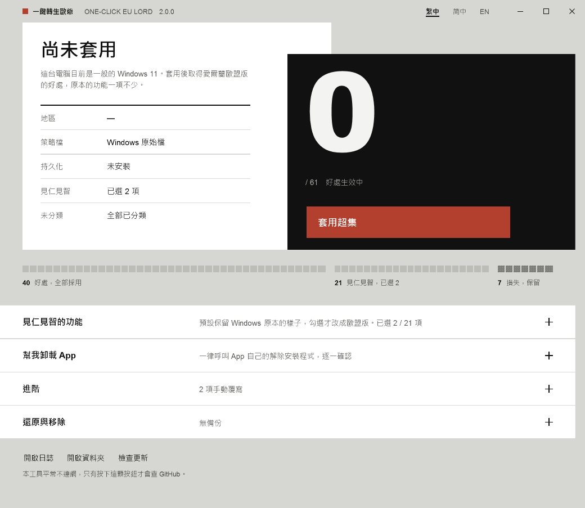

# 一鍵轉生歐爺

**繁體中文** · [简体中文](README.zh-CN.md) · [English](README.en.md)

把一台普通安裝的 Windows 11，變成享有愛爾蘭（歐盟＋EEA）待遇的機器 —— **只收好處，不收損失**，而且更新之後也不會被刷回去。



---

## 三步驟

1. 到 [Releases](https://github.com/PZW152/one-click-eu-lord/releases/latest) 下載 **`EULord.exe`**
2. 雙擊它，按「是」允許系統管理員權限
3. 按紅色那顆 **套用超集**

就這樣。不用安裝、不用設定、不用看說明。

### 如果 Windows 或瀏覽器擋下來

這支程式**沒有買程式碼簽章憑證**，所以 Windows 會對它陌生。這是最常見的「用不了」原因，而且不代表程式有問題：

- **瀏覽器說「不常下載，可能有危險」** → 在下載項目上選「保留」。
- **藍色的「Windows 已保護您的電腦」** → 按「其他資訊」→「仍要執行」。
- **防毒軟體有意見** → 這支程式會把 `reg.exe` 複製成暫時的檔名來寫一個登錄值（見 [docs/HOW-IT-WORKS.md](docs/HOW-IT-WORKS.md) 第 7 節），有些防毒會把這個動作當成可疑行為。原始碼全部公開，也可以自己編譯。

不想按這些警告的話，[自己編譯](#自己編譯)只要一行指令，而且不用先裝任何東西。

---

## 為什麼不是「直接改成歐盟」就好？

歐盟版的 Windows 不只是**多**了東西，它也**拿掉**了一些東西。

把地區改成愛爾蘭（網路上常見的做法）會讓你得到歐盟的好處，但同時會失去朗讀程式的腳本擴充、Xbox 全螢幕體驗、時鐘與行事曆的快速動作等等 —— 這些功能在歐盟版裡是被關掉的。

所以這個工具把 **68 條**歐盟與全球不同的策略逐條分類：

| 分類 | 數量 | 處理方式 |
|------|------|----------|
| **好處** | 40 | 採用歐盟版 |
| **損失** | 7 | **保留原本的**，不收歐盟版 |
| **見仁見智** | 21 | 預設保留原本的，想要再自己勾 |

這就是「超集」的意思：歐盟有的好處你全都有，歐盟沒有的功能你也還留著。

完整的逐條對照在 [docs/POLICIES.md](docs/POLICIES.md)。

> 誠實地說：**預設狀態下，這個工具不會關掉你現有的任何功能。** 會關掉東西的只有兩種情況，而且都要你自己動手 —— 你在「見仁見智」裡勾選的項目，以及你在「幫我卸載 App」裡點的卸載。

---

## 它在你的機器上動了什麼

| 項目 | 內容 |
|------|------|
| `C:\Windows\System32\IntegratedServicesRegionPolicySet.json` | 改寫成上表的結果，並移除地區條件（先備份） |
| `HKLM\...\Control Panel\DeviceRegion` | 設成愛爾蘭（GeoID 68） |
| 排程工作 `OneClickEULord-Persist` | 登入時、每天、以及 **Windows 更新完成後**自動補回 |
| `C:\ProgramData\OneClickEULord\` | 自己的複本、設定、備份、日誌，全部集中在這一個資料夾 |

除此之外不碰任何地方。不裝服務、不裝驅動、不常駐、平常不連網。

---

## 還原

打開工具 → 展開「還原與移除」：

- **還原**：策略檔換回備份、地區改回原值、移除排程。備份會留著。
- **完全移除**：還原之後再刪掉整個 `C:\ProgramData\OneClickEULord\`。需要再次確認。

手上那個 `EULord.exe` 可以隨便移動或刪除 —— 工具會把自己複製一份到 ProgramData 給排程用。

---

## 關於卸載 App

展開「幫我卸載 App」可以移除 Edge、Microsoft Store、Copilot、手機連結、小工具、Xbox、Teams、OneDrive 等微軟自家 App。

**一律呼叫 App 自己註冊的卸載程式**（Store App 走 `Remove-AppxPackage`，Edge 與 OneDrive 走它們登錄在系統裡的解除安裝命令），絕不手動刪檔案、不動 WinSxS、不強制移除沒有卸載程式的東西。找不到合法卸載途徑的，就標示為不可卸並說明原因；卸載失敗就原樣回報結束碼，**不會退回硬刪**。

每個 App 都要分別確認一次，不是一次確認全部。已卸載的項目會有「重新安裝」按鈕帶你去官方頁面。

---

## 命令列（進階、IT 批量部署）

雙擊是圖形介面；帶參數就不開視窗。

```
EULord.exe --apply                    套用超集
EULord.exe --reapply                  有跑掉才補回（排程跑的就是這個）
EULord.exe --restore                  還原
EULord.exe --purge --yes              還原並刪掉資料夾
EULord.exe --status [--json]          只回報，不改任何東西

EULord.exe --region IE                改用別的 EEA 國家（ISO 碼或 GeoID）
EULord.exe --choice Copilot,OfficeRecent    指定要開的「見仁見智」項目
EULord.exe --override NarratorScripts=eea   逐條強制（eea / global / auto）
```

結束碼：`0` 完成、`1` 失敗、`2` 參數錯誤、`3` 需要系統管理員、`4` 部分完成。

卸載 App **不提供**命令列 —— 移除軟體必須有人逐一確認，不該能無人值守執行。

---

## 套用之後沒看到效果？

微軟是分批推送這些功能的，寫進設定不等於介面馬上出現。工具套用完會**實際讀回來驗證**，每一項顯示「已生效 / 尚未生效 / 無法判斷」，並說明可能的原因（還沒重開機、微軟還沒推到這台、公司網域或 MDM 原則蓋過去了）。

日誌在 `C:\ProgramData\OneClickEULord\logs\eulord.log`，**一律英文、公曆時間**，方便直接貼到 issue。

---

## 自己編譯

不需要 SDK、不需要 NuGet、不需要 Visual Studio。.NET Framework 4.8 是 Windows 11 內建的。

```powershell
.\tools\Build.ps1     # 產出 dist\EULord.exe，約 165 KB
.\tools\Test.ps1      # 280 項測試，不需要系統管理員，不碰系統
```

技術細節在 [docs/HOW-IT-WORKS.md](docs/HOW-IT-WORKS.md)，設計決策的完整記錄在 [docs/SPEC.md](docs/SPEC.md)。

---

## 文件

| 文件 | 說明 |
|------|------|
| [docs/POLICIES.md](docs/POLICIES.md) | 68 條策略逐條對照（由程式產生，三語） |
| [docs/HOW-IT-WORKS.md](docs/HOW-IT-WORKS.md) | 原理：Windows 怎麼決定歐盟待遇，我們怎麼介入 |
| [docs/SPEC.md](docs/SPEC.md) | v2 的規格與決策記錄 |
| [docs/RELEASING.md](docs/RELEASING.md) | 發佈流程（維護者用，英文） |
| [SECURITY.md](SECURITY.md) | 安全性考量與回報方式 |
| [CHANGELOG.md](CHANGELOG.md) | 版本紀錄 |

> 使用者文件有三種語言；維護者文件只有一份，避免翻譯之間互相矛盾。

---

## 授權

[MIT](LICENSE)。這是一個獨立的開源專案，與微軟沒有任何關係。
