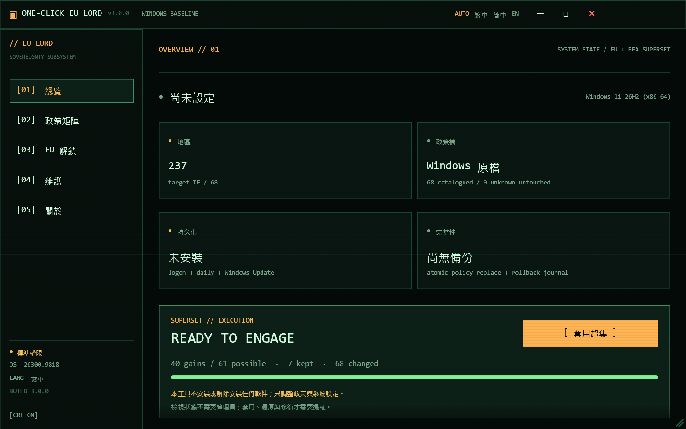

# 一键转生欧爷 · One-Click EU Lord v3

[繁體中文](README.md) · **简体中文** · [English](README.en.md)

> 纯 Rust 重写。界面是复古未来主义 TUI 风格的真实 GUI，可直接用鼠标操作。

> 重要：**本工具不安装、不卸载任何软件。** 它只调整 Windows 的 EU/EEA 政策文件、地区和持久化计划任务；软件卸载请使用 Windows「设置 → 应用」。

## 规则

Windows 的 EU/EEA 政策文件里有 68 条与全球版不同的条目：

| 类别 | 数量 | 处理 |
|---|---:|---|
| 好处 Benefit | 40 | 采用 EU/EEA 状态 |
| 损失 Loss | 7 | 保留全球状态 |
| 见仁见智 Choice | 21 | 默认保留全球；勾选后才采用 EU |

未分类策略保持 Windows 原样，不重写、不移除 conditions。

## 界面



- 侧边栏：总览、政策矩阵、EU 解锁、维护、关于。
- 第一次套用前显示差异摘要；成功套用后按钮即为一键套用。
- 简单模式只列 21 个见仁见智项目；专家模式可搜索全部 68 条并逐条选 AUTO / EU / GLOBAL。
- 自定义标题栏、CRT 扫描线、琥珀/青绿 retro-futurist 配色。

## 使用

1. 从 Releases 下载 `EULord.exe`。
2. 直接运行；GUI 以普通权限启动，只有套用/还原时才请求 UAC。
3. 第一次按「开始扫描」，确认 Windows build 与政策文件。
4. 到「政策矩阵」确认 40/7/21；见仁见智默认不勾。
5. 按「套用超集」，第一次确认差异后执行。

套用流程：备份 → 还原点 → 原子替换政策文件 → 写入地区 → 安装计划任务 → 验证；关键步骤失败自动回滚。计划任务在登录、每日与 Windows Update 后补回。

## 安全

- 政策文件使用原子替换，不就地截断。
- 备份、journal、验证与失败回滚。
- 管理员套用时收紧 `C:\\ProgramData\\OneClickEULord` 的 ACL。
- GUI 不默认提权，需要时通过 `ShellExecuteExW(runas)` 启动 worker。
- 没有软件卸载执行路径；EU 解锁页只显示政策信息。

## CLI

```powershell
eulord status --json
eulord plan --json
eulord verify --json
eulord apply --json
eulord repair --json
eulord reapply --json
eulord restore --json
eulord purge --yes --json
eulord export .\\state.json
eulord import .\\state.json
```

退出码：0 成功、1 错误、2 需要确认、3 需要管理员、4 部分完成或验证失败。

## 构建

```powershell
cargo test --workspace --locked
cargo build --release --locked --bin eulord
.\\tools\\Build.ps1 -Profile release
.\\tools\\Test.ps1
```

## MSIX 与签名

`packaging/` 与 `tools/Pack-Msix.ps1` 已包含 MSIX 和 `.appinstaller` 自动更新管线，但仓库不包含代码签名证书。需要提供受信任 PFX，并把 `packaging/AppxManifest.xml` 的 Publisher 改成证书 subject。没有证书时请使用可携带版。

## 数据位置

- `C:\\ProgramData\\OneClickEULord\\`：程序副本、备份、journal、日志、状态。
- `%LOCALAPPDATA%\\OneClickEULord\\state.json`：普通权限下的 UI 偏好与未提权状态备用。
- 政策文件：`C:\\Windows\\System32\\IntegratedServicesRegionPolicySet.json`。
- 地区：`HKLM\\SOFTWARE\\Microsoft\\Windows\\CurrentVersion\\Control Panel\\DeviceRegion`。
- 计划任务：`OneClickEULord-Persist`。

## 限制

- 目前只验证 x64；arm64 需用 arm64 target 构建并重新打包。
- 未分类策略保持原样，不保证覆盖未来 Windows build。
- MSIX 证书是外部依赖；默认只发布可携带版。
- 不做软件卸载、不绕过 UCPD、不改 Microsoft 账户或授权状态。

## 授权

MIT。与 Microsoft 无关。

