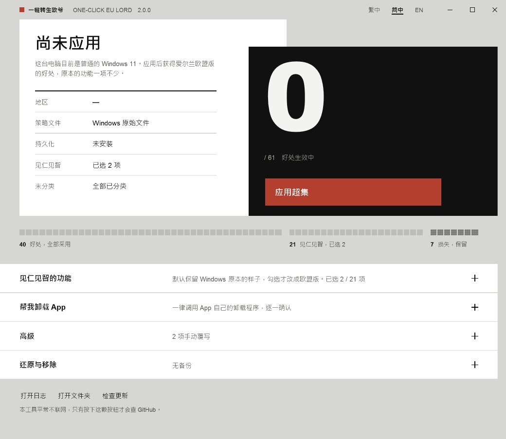

# 一键转生欧爷

[繁體中文](README.md) · **简体中文** · [English](README.en.md)

把一台普通安装的 Windows 11，变成享有爱尔兰（欧盟＋EEA）待遇的机器 —— **只收好处，不收损失**，而且更新之后也不会被刷回去。



<sub>深色模式：[docs/images/screenshot-zh-Hant-dark.png](docs/images/screenshot-zh-Hant-dark.png)。界面跟随 Windows 的浅色／深色设置自动切换。</sub>

## 建议与反馈

欢迎提出新功能、操作流程、界面文字、文档补充或实际使用中的建议。不需要懂编程，直接用中文描述即可。

- [前往建议征集帖](https://github.com/PZW152/one-click-eu-lord/issues/2)
- [提交一条新的功能建议](https://github.com/PZW152/one-click-eu-lord/issues/new?template=feature_request.md)

---

---

## 三步骤

1. 到 [Releases](https://github.com/PZW152/one-click-eu-lord/releases/latest) 下载 **`EULord.exe`**
2. 双击它，按「是」允许管理员权限
3. 按红色那颗 **应用超集**

就这样。不用安装、不用设置、不用看说明。

### 如果 Windows 或浏览器拦下来

这个程序**没有买代码签名证书**，所以 Windows 会对它陌生。这是最常见的「用不了」原因，而且不代表程序有问题：

- **浏览器说「不常下载，可能有危险」** → 在下载项上选「保留」。
- **蓝色的「Windows 已保护你的电脑」** → 按「更多信息」→「仍要运行」。
- **杀毒软件有意见** → 这个程序会把 `reg.exe` 复制成临时文件名来写一个注册表值（见 [docs/HOW-IT-WORKS.md](docs/HOW-IT-WORKS.md) 第 7 节），有些杀软会把这个动作当成可疑行为。源码全部公开，也可以自己编译。

不想点这些警告的话，[自己编译](#自己编译)只要一行命令，而且不用先装任何东西。

---

## 为什么不是「直接改成欧盟」就好？

欧盟版的 Windows 不只是**多**了东西，它也**拿掉**了一些东西。

把区域改成爱尔兰（网上常见的做法）会让你得到欧盟的好处，但同时会失去讲述人的脚本扩展、Xbox 全屏体验、时钟与日历的快速操作等等 —— 这些功能在欧盟版里是被关掉的。

所以这个工具把 **68 条**欧盟与全球不同的策略逐条分类：

| 分类 | 数量 | 处理方式 |
|------|------|----------|
| **好处** | 40 | 采用欧盟版 |
| **损失** | 7 | **保留原本的**，不收欧盟版 |
| **见仁见智** | 21 | 默认保留原本的，想要再自己勾 |

这就是「超集」的意思：欧盟有的好处你全都有，欧盟没有的功能你也还留着。

完整的逐条对照在 [docs/POLICIES.md](docs/POLICIES.md)。

> 诚实地说：**默认状态下，这个工具不会关掉你现有的任何功能。** 会关掉东西的只有两种情况，而且都要你自己动手 —— 你在「见仁见智」里勾选的项目，以及你在「帮我卸载 App」里点的卸载。

---

## 它在你的机器上动了什么

| 项目 | 内容 |
|------|------|
| `C:\Windows\System32\IntegratedServicesRegionPolicySet.json` | 改写成上表的结果，并移除区域条件（先备份） |
| `HKLM\...\Control Panel\DeviceRegion` | 设成爱尔兰（GeoID 68） |
| 计划任务 `OneClickEULord-Persist` | 登录时、每天、以及 **Windows 更新完成后**自动补回 |
| `C:\ProgramData\OneClickEULord\` | 自己的副本、设置、备份、日志，全部集中在这一个文件夹 |

除此之外不碰任何地方。不装服务、不装驱动、不常驻、平常不联网。

---

## 还原

打开工具 → 展开「还原与移除」：

- **还原**：策略文件换回备份、区域改回原值、移除计划任务。备份会留着。
- **完全移除**：还原之后再删掉整个 `C:\ProgramData\OneClickEULord\`。需要再次确认。

手上那个 `EULord.exe` 可以随便移动或删除 —— 工具会把自己复制一份到 ProgramData 给计划任务用。

---

## 关于卸载 App

展开「帮我卸载 App」可以移除 Edge、Microsoft Store、Copilot、手机连接、小组件、Xbox、Teams、OneDrive 等微软自家 App。

**一律调用 App 自己注册的卸载程序**（Store App 走 `Remove-AppxPackage`，Edge 与 OneDrive 走它们注册在系统里的卸载命令），绝不手动删文件、不动 WinSxS、不强制移除没有卸载程序的东西。找不到合法卸载途径的，就标示为不可卸并说明原因；卸载失败就原样报告退出码，**不会退回硬删**。

每个 App 都要分别确认一次，不是一次确认全部。已卸载的项目会有「重新安装」按钮带你去官方页面。

---

## 命令行（高级、IT 批量部署）

双击是图形界面；带参数就不开窗口。

```
EULord.exe --apply                    应用超集
EULord.exe --reapply                  有跑掉才补回（计划任务跑的就是这个）
EULord.exe --restore                  还原
EULord.exe --purge --yes              还原并删掉数据文件夹
EULord.exe --status [--json]          只报告，不改任何东西

EULord.exe --region IE                改用别的 EEA 国家（ISO 码或 GeoID）
EULord.exe --choice Copilot,OfficeRecent    指定要开的「见仁见智」项目
EULord.exe --override NarratorScripts=eea   逐条强制（eea / global / auto）
```

退出码：`0` 完成、`1` 失败、`2` 参数错误、`3` 需要管理员、`4` 部分完成。

卸载 App **不提供**命令行 —— 移除软件必须有人逐一确认，不该能无人值守执行。

---

## 应用之后没看到效果？

微软是分批推送这些功能的，写进设置不等于界面马上出现。工具应用完会**实际读回来验证**，每一项显示「已生效 / 尚未生效 / 无法判断」，并说明可能的原因（还没重启、微软还没推到这台、公司域或 MDM 策略覆盖了）。

日志在 `C:\ProgramData\OneClickEULord\logs\eulord.log`，**一律英文、公历时间**，方便直接贴到 issue。

---

## 自己编译

不需要 SDK、不需要 NuGet、不需要 Visual Studio。.NET Framework 4.8 是 Windows 11 内置的。

```powershell
.\tools\Build.ps1     # 产出 dist\EULord.exe，约 165 KB
.\tools\Test.ps1      # 280 项测试，不需要管理员，不碰系统
```

技术细节在 [docs/HOW-IT-WORKS.md](docs/HOW-IT-WORKS.md)，设计决策的完整记录在 [docs/SPEC.md](docs/SPEC.md)。

---

## 文档

| 文档 | 说明 |
|------|------|
| [docs/POLICIES.md](docs/POLICIES.md) | 68 条策略逐条对照（由程序生成，三语） |
| [docs/HOW-IT-WORKS.md](docs/HOW-IT-WORKS.md) | 原理：Windows 怎么决定欧盟待遇，我们怎么介入 |
| [docs/SPEC.md](docs/SPEC.md) | v2 的规格与决策记录 |
| [docs/RELEASING.md](docs/RELEASING.md) | 发布流程（维护者用，英文） |
| [SECURITY.md](SECURITY.md) | 安全性考量与报告方式 |
| [CHANGELOG.md](CHANGELOG.md) | 版本记录 |

> 用户文档有三种语言；维护者文档只有一份，避免翻译之间互相矛盾。

---

## 许可

[MIT](LICENSE)。这是一个独立的开源项目，与微软没有任何关系。
